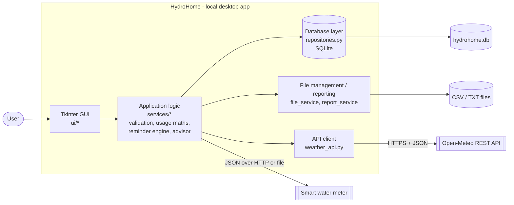

# System Architecture



ASCII version:
```
 [User] -> [Tkinter GUI] -> [Application logic (services)] -> [Database layer] -> hydrohome.db
                                  |  \-> [File mgmt/reporting] -> CSV / TXT
                                  |----> [API client] ==HTTPS/JSON==> Open-Meteo
                                  \----> [Meter sync] ==JSON (URL/file)==> Smart meter
```

## Responsibilities
| Layer | Package | Knows about | Must NOT contain |
|---|---|---|---|
| Presentation | `ui/` | services | SQL, HTTP |
| Business logic | `services/` | repositories, API client | Tkinter |
| Data access | `database/` | sqlite3 | business rules |
| API access | `services/weather_api.py` | requests | database, Tkinter |
| Files | `services/file_service.py` | csv, pathlib | database |

* **High cohesion:** each module has one job (e.g. `consumption.py` is pure functions that only do usage maths).
* **Low coupling:** the UI talks to one `Services` object built in `container.py` (composition root);
  services receive repositories/clients by constructor, so tests substitute a temp DB and a fake HTTP session.
* **Maintainability:** thresholds live in `config.py`; all errors derive from `AppError`, so the UI has a single `guarded()` handler.
* **Exceptions:** `sqlite3.Error → DatabaseError`, `requests.* → WeatherError`, `OSError → FileServiceError`,
  bad input → `ValidationError` (lists every problem at once).

## Key flows
1. **Add reading:** ReadingsView → `ReadingService.add` → `validate_reading` → sequence check (meter never decreases) → `ReadingRepository.add`.
2. **Reminder alert:** `after()` timer → `ReminderService.collect_due_alerts` → `due_unnotified` query → popup → `mark_notified`.
3. **Weather advice:** Dashboard thread → `WeatherService` (geocode once, cache lat/lon) → `WeatherClient` → `Forecast` → `advisor` → Suggestion → prefilled reminder form.
5. **Dashboard auto-update:** `after()` timer (10 s) → quiet `refresh()` → services re-read the DB → widgets redraw; `ForecastCache` decides whether the API is called (empty, older than 30 min, or retry window passed after an error).
4. **Smart meter auto-sync:** `after()` timer (60 s) → background thread → `MeterSyncService.sync_due` → fetch JSON → extract value by path → convert to m³ → `ReadingService.add/update` (same rules as manual entry) → result saved on `meter_sources` → status bar + screen refresh.
